# 第 11 章 Azure DevOps 整合：同一個故事再走一次

第 8 天的事故處理完後，公司決定把平台組的 Repo 與 Pipeline 統一搬到 Azure DevOps（以下簡稱 ADO），理由是其他部門的 Boards、權限與稽核都已在 ADO 上。小靈接下任務：**流程不變，只換工具**。本章用同一個「優惠券折抵」情境，在真實的 ADO 組織上一步一步重建第 1 到第 10 章的做法，每一步都附實際操作截圖。

讀完本章你會知道：

1. GitHub 的每個做法在 ADO 叫什麼、設定在哪裡。
2. 哪些地方 ADO 做法不同，需要額外處理（CODEOWNERS、Draft 判斷、Sigstore keyless、Hosted Agent 配額）。
3. Argo CD 怎麼改成從 Azure Repos 拉取，GitOps 的 Pull 模型完全不變。

## 11.1 對照表：GitHub → Azure DevOps

| 第幾章 | GitHub 做法 | Azure DevOps 對應 | 差異重點 |
| --- | --- | --- | --- |
| 2 | Issue + Issue Template | Boards 的 User Story（Agile 流程） | 驗收條件有專屬欄位 Acceptance Criteria |
| 2 | Draft PR | Azure Repos 的 Draft PR（Create as draft） | Draft 狀態不通知 Reviewer |
| 2 | `Closes #42` | 在 commit 或 PR 寫 `AB#1`，或在 PR 的 Work items 區塊連結 | 合併時可勾「Complete associated work items」自動關閉 |
| 2 | `.github/pull_request_template.md` | `.azuredevops/pull_request_template.md` | 路徑不同，語法相同（Markdown checklist） |
| 4 | GitHub Actions `pr-check.yml` | Azure Pipelines YAML + Branch Policy 的 Build validation | Azure Repos 的 PR 觸發由 Branch Policy 控制，不用 `pr:` 區塊 |
| 4 | `if: github.event.pull_request.draft == false` | 無預定義變數，需呼叫 PR API 取得 `isDraft` | 見 11.6 |
| 5 | Branch Protection | Branch Policies + Repo Security | 最少審核人數、連結 Work Item、留言需解決、只允許 Squash |
| 5 | CODEOWNERS | Branch Policy 的 Automatically included reviewers + 路徑過濾 | ADO 不讀 CODEOWNERS 檔 |
| 6 | `azure/login` + OIDC | Service Connection（Workload Identity Federation） | 一樣沒有長期密碼 |
| 6 | `peter-evans/create-pull-request` + auto-merge 標籤 | `az repos pr create --auto-complete true` | 用 Build Service 身分開 PR |
| 6、9 | cosign keyless（GitHub OIDC → Fulcio） | cosign 搭配 Key Vault 金鑰（`azurekms://`） | Azure Pipelines 不是 Sigstore 的 keyless 身分來源 |
| 7 | Argo CD 讀 GitHub（GitHub App） | Argo CD 讀 Azure Repos（Azure Workload Identity 或 PAT） | Application 只改 `repoURL` |
| 7 | GitHub Webhook → `/api/webhook` | Service Hooks（Code pushed）→ `/api/webhook` | 可設 Basic Auth |
| 10 | git log + PR 歷史 | git log + PR 歷史 + Work Item 雙向連結 + Auditing | Work Item 自動顯示相關 commit 與 PR |

## 11.2 示範環境

| 項目 | 值 |
| --- | --- |
| 組織 | `dev.azure.com/cpingwang0948` |
| 專案 | `gitops-tutorial-demo`（Private，Git，Agile 流程） |
| App Repo | `order-service` |
| Config Repo | `platform-gitops` |
| Pipelines | `order-service-pr-check`、`order-service-release`、`platform-gitops-pr-check` |
| 團隊 | `Platform Engineers`（取代 GitHub 的 `@platform-org/platform-engineers`） |
| 編號對照 | GitHub Issue #42 → Work Item #1；PR #45 → PR !1 |

新專案的 Work Item 從 1 開始編號，所以本章的 #1 就是前面章節的 Issue #42。

## Step 1 建立專案

Organization 首頁 → **New project**。

- Project name：`gitops-tutorial-demo`
- Visibility：Private
- Advanced → Version control：**Git**；Work item process：**Agile**

選 Agile 而不是預設的 Basic，是因為 Agile 的 User Story 有獨立的 **Acceptance Criteria** 欄位，正好放第 2 章老陳寫的五條驗收條件。

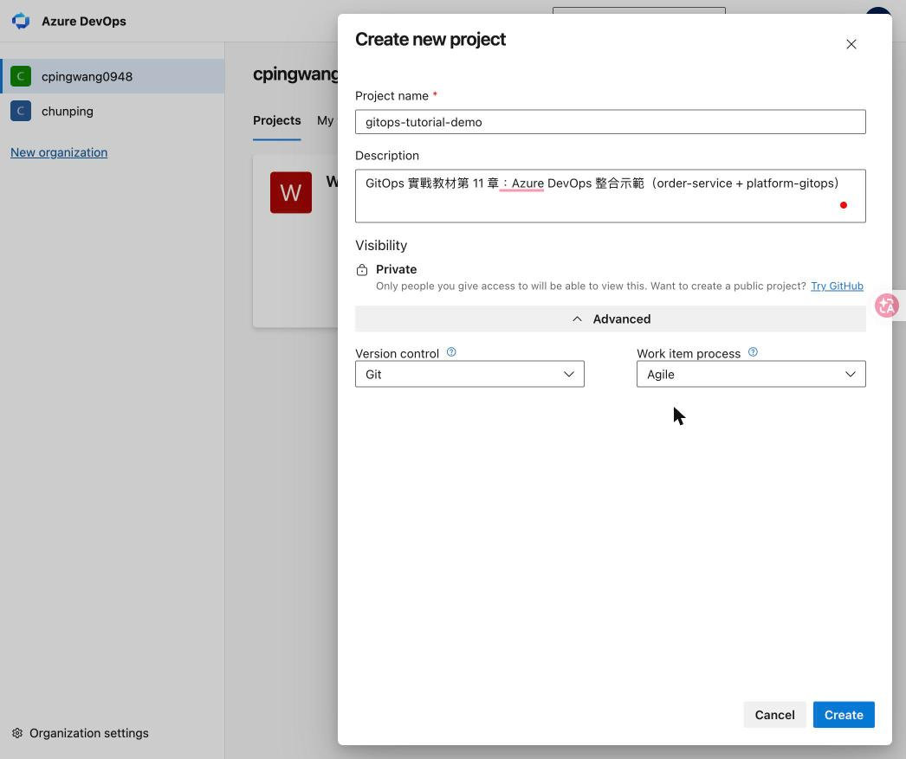

## Step 2 Boards：用 User Story 取代 Issue

Boards → Work items → New Work Item → **User Story**。

- Title：結帳支援優惠券折抵
- Description：背景與非功能需求
- Acceptance Criteria：第 2 章的五條驗收條件
- Tags：`coupon`、`double-11`；Story Points：5

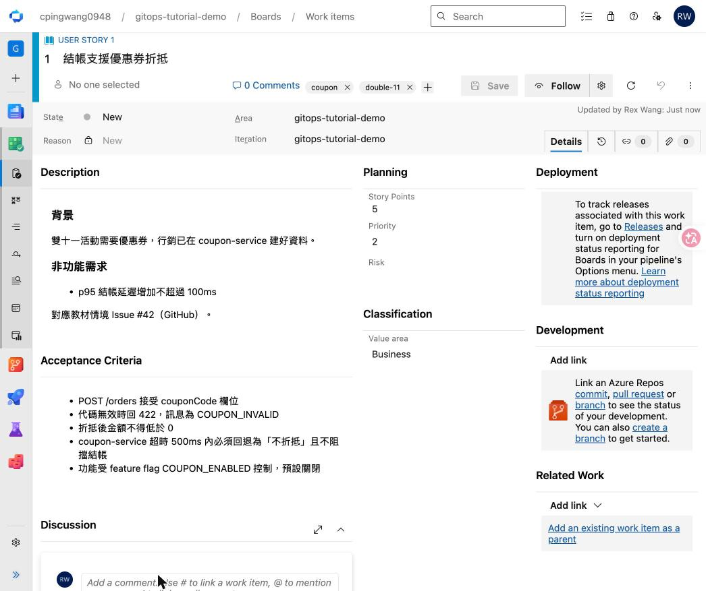

右側的 **Development** 區塊目前是空的，等 Step 7 有 commit 與 PR 之後會自動長出連結。

用 CLI 建立的等效指令（需先 `az extension add --name azure-devops`）：

```bash
az boards work-item create --type "User Story" \
  --title "結帳支援優惠券折抵" \
  --fields "Microsoft.VSTS.Common.AcceptanceCriteria=<ul><li>POST /orders 接受 couponCode 欄位</li>...</ul>" \
  --org https://dev.azure.com/cpingwang0948 --project gitops-tutorial-demo
```

## Step 3 Repos：建立 App Repo 與 Config Repo

Repos → 上方 Repo 下拉選單 → **New repository**，建立 `order-service` 與 `platform-gitops`。目錄結構與第 1 章相同，只有兩處不同：

| 檔案 | GitHub | Azure DevOps |
| --- | --- | --- |
| CI 定義 | `.github/workflows/*.yml` | `azure-pipelines/*.yml`（路徑自訂，建 Pipeline 時指定） |
| PR 範本 | `.github/pull_request_template.md` | `.azuredevops/pull_request_template.md` |

已有 GitHub Repo 的團隊可用 **Import repository** 直接搬，歷史與 tag 都會保留：

```bash
az repos import create --git-source-url https://github.com/platform-org/order-service.git \
  --repository order-service --org https://dev.azure.com/cpingwang0948 --project gitops-tutorial-demo
```

本示範的起點與第 1 章相同：`order-service` 的 main 是 1.7.2（已打 tag `v1.7.2`），`platform-gitops` 三個環境都指向 1.7.2。

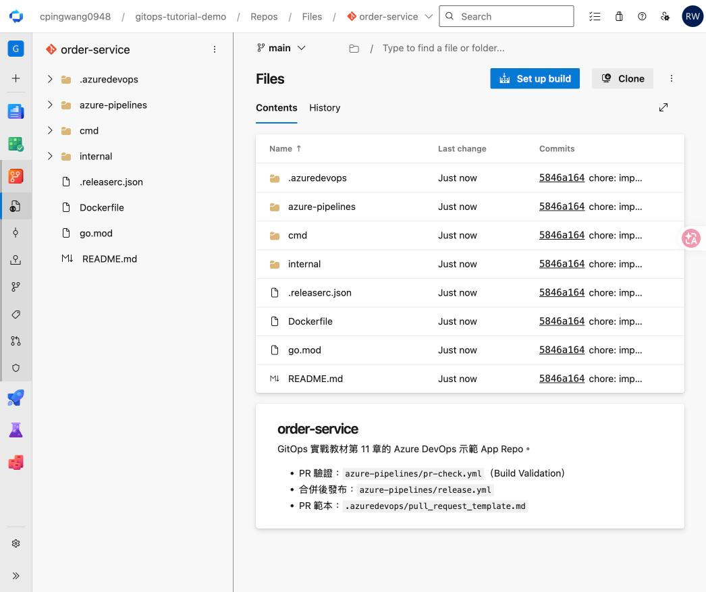

`.azuredevops/pull_request_template.md`：

```markdown
AB#<Work Item 編號>

## 工項
- [ ] 

## 設計要點

## 測試方式

## 部署注意
無
```

第一行改成 `AB#<編號>`：ADO 會把 PR 與 Work Item 連起來，作用等同 GitHub 的 `Closes #42`。

## Step 4 Pipelines：從現有 YAML 建立 Pipeline

Pipelines → **New pipeline** → Azure Repos Git → 選 `order-service` → **Existing Azure Pipelines YAML file** → Path 選 `/azure-pipelines/pr-check.yml`。

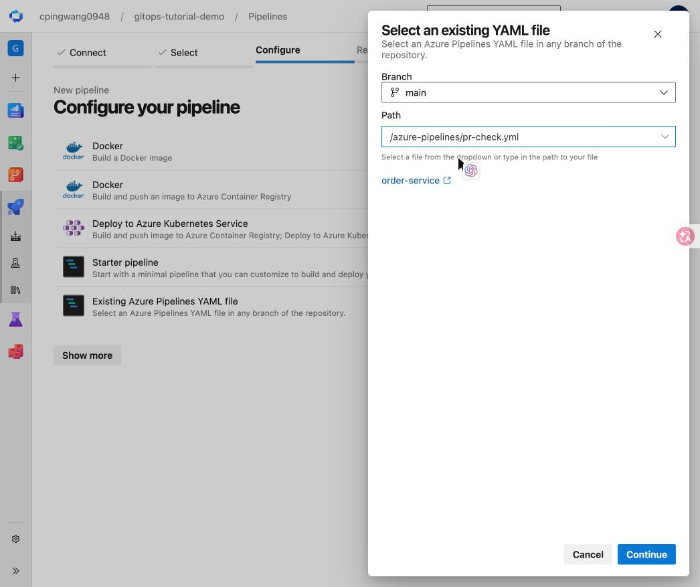

在 Review 頁面不要按 Run，按右側下拉選單的 **Save**（PR 驗證要由 Branch Policy 觸發）。存好後把 Pipeline 改名為 `order-service-pr-check`，同樣方式建立 `order-service-release` 與 `platform-gitops-pr-check`。

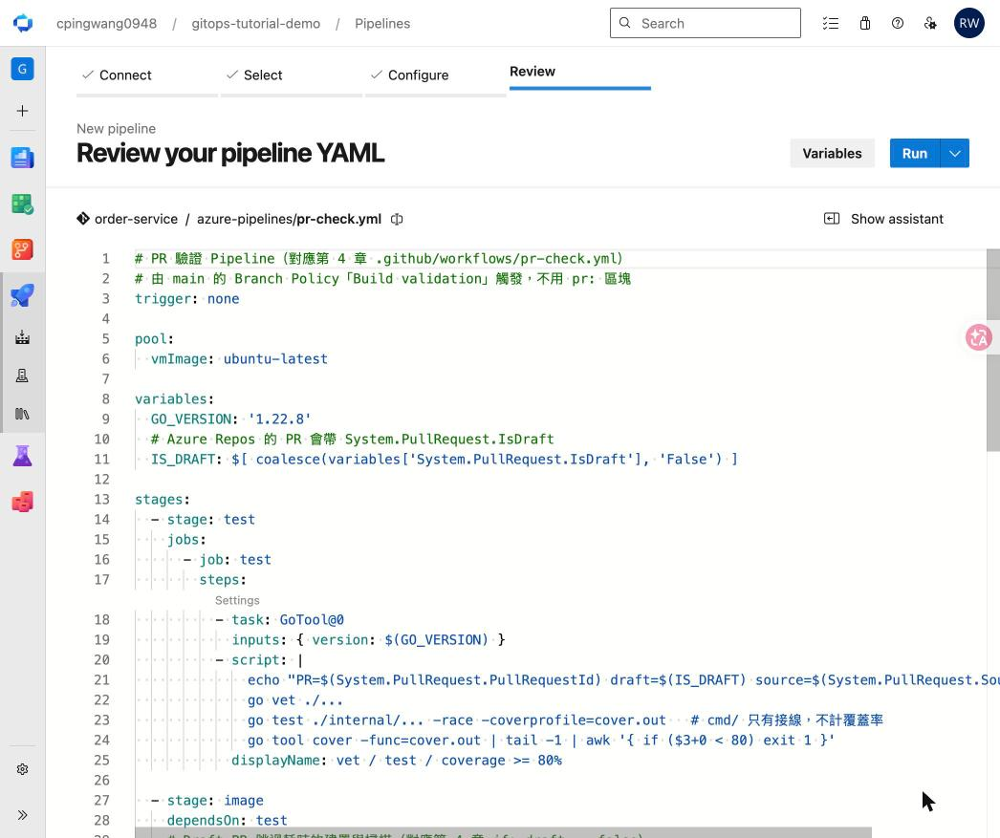

### order-service 的 PR 驗證（對應第 4 章）

```yaml
# azure-pipelines/pr-check.yml
trigger: none          # 由 Branch Policy「Build validation」觸發

pool:
  vmImage: ubuntu-latest

variables:
  GO_VERSION: '1.22.8'

stages:
  - stage: test
    jobs:
      # Azure Pipelines 沒有「PR 是否為 Draft」的預定義變數，
      # 用 Build Service 的 token 查 PR API 取得 isDraft
      - job: meta
        steps:
          - checkout: none
          - bash: |
              url="$(System.CollectionUri)$(System.TeamProjectId)/_apis/git/repositories/$(Build.Repository.ID)/pullRequests/$(System.PullRequest.PullRequestId)?api-version=7.1"
              draft=$(curl -sf -H "Authorization: Bearer $SYSTEM_ACCESSTOKEN" "$url" | jq -r .isDraft)
              echo "##vso[task.setvariable variable=isDraft;isOutput=true]$draft"
            name: pr
            env: { SYSTEM_ACCESSTOKEN: $(System.AccessToken) }

      - job: test
        steps:
          - task: GoTool@0
            inputs: { version: $(GO_VERSION) }
          - script: |
              go vet ./...
              go test ./internal/... -race -coverprofile=cover.out
              go tool cover -func=cover.out | tail -1 | awk '{ if ($3+0 < 80) exit 1 }'
            displayName: vet / test / coverage >= 80%

  - stage: image
    dependsOn: test
    # Draft PR 跳過耗時的建置與掃描（對應第 4 章 if: draft == false）
    condition: and(succeeded(), ne(dependencies.test.outputs['meta.pr.isDraft'], 'true'))
    jobs:
      - job: build_scan
        steps:
          - script: docker build -t order-service:pr-$(System.PullRequest.PullRequestId) .
            displayName: docker build（只建不推）
          - script: |
              docker run --rm -v /var/run/docker.sock:/var/run/docker.sock \
                aquasec/trivy:0.57.0 image --severity CRITICAL --exit-code 1 \
                order-service:pr-$(System.PullRequest.PullRequestId)
            displayName: trivy（Critical 即失敗）

  - stage: manifests
    dependsOn: []
    jobs:
      - job: kustomize
        steps:
          - checkout: self
          - checkout: git://$(System.TeamProject)/platform-gitops   # 同專案另一個 Repo
          - script: |
              curl -sSL https://github.com/yannh/kubeconform/releases/download/v0.6.7/kubeconform-linux-amd64.tar.gz | tar xz
              for env in dev staging prod; do
                kubectl kustomize platform-gitops/apps/order-service/overlays/$env \
                  | ./kubeconform -strict -summary
              done
            displayName: kustomize build + kubeconform
```

和第 4 章 GitHub Actions 版本的三個差異：

- 沒有 `on: pull_request`。Azure Repos 的 PR 觸發一律由 Branch Policy 的 Build validation 決定，YAML 用 `trigger: none` 避免 push 到任何分支都跑。
- 兩個 `checkout` 時，各 Repo 會被放到 `$(Build.SourcesDirectory)/<repo 名稱>` 子目錄。
- Draft 判斷改成查 PR API。實測 PR 觸發的 run 中，`System.PullRequest.*` 只有 PullRequestId、SourceBranch、TargetBranch、SourceCommitId 等欄位，沒有 Draft 狀態。

## Step 5 Branch Policies：取代 Branch Protection

Project settings → Repositories → `order-service` → Policies → Branch Policies → `main`。

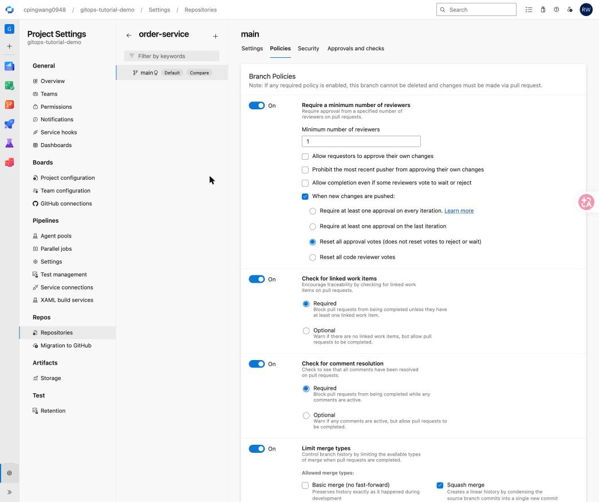

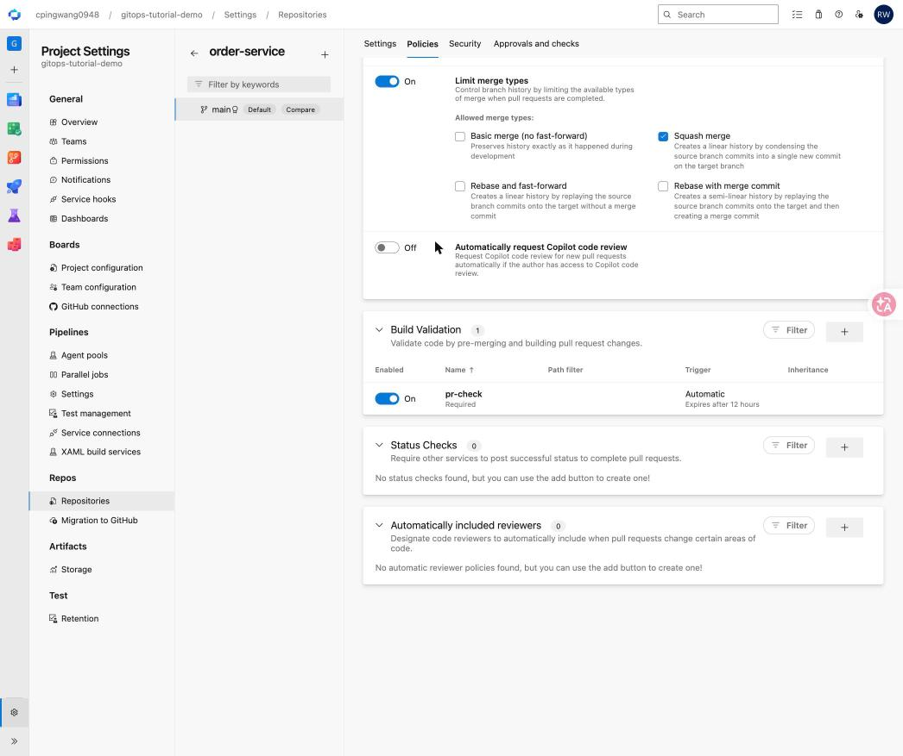

| 第 5 章 GitHub 設定 | ADO Branch Policy | 本示範設定 |
| --- | --- | --- |
| 需要 PR 才能合併 | 任一 Required policy 開啟即生效 | 自動成立 |
| 最少批准人數 1 | Require a minimum number of reviewers | 1；不允許作者自審；有新 push 時重置批准 |
| 必須通過 status checks | Build Validation | `pr-check`，Required，Automatic，12 小時後過期 |
| （無直接對應） | Check for linked work items | Required：沒有連 Work Item 不能合併 |
| 對話須解決 | Check for comment resolution | Required |
| 只允許 Squash | Limit merge types | 只勾 Squash merge |
| 禁止 force push、管理員也受限 | Repos → Security → Force push：Deny；Bypass policies：不授予 | 預設 Contributors 就沒有 Force push 權限 |

**Check for linked work items** 是 ADO 多出來的好處：第 10 章「從叢集回推到需求」的鏈條，在 ADO 由平台強制，不靠人記得寫 `Closes`。

用 CLI 設定的等效指令：

```bash
REPO_ID=$(az repos show -r order-service --query id -o tsv)
az repos policy approver-count create --repository-id $REPO_ID --branch main \
  --minimum-approver-count 1 --creator-vote-counts false --reset-on-source-push true \
  --allow-downvotes false --blocking true --enabled true
az repos policy work-item-linking create --repository-id $REPO_ID --branch main --blocking true --enabled true
az repos policy comment-required create --repository-id $REPO_ID --branch main --blocking true --enabled true
az repos policy merge-strategy create --repository-id $REPO_ID --branch main \
  --allow-squash true --allow-no-fast-forward false --allow-rebase false --allow-rebase-merge false \
  --blocking true --enabled true
az repos policy build create --repository-id $REPO_ID --branch main \
  --build-definition-id <order-service-pr-check 的 ID> --display-name pr-check \
  --queue-on-source-update-only true --manual-queue-only false --valid-duration 720 \
  --blocking true --enabled true
```

## Step 6 Config Repo：用「自動加入審核者」取代 CODEOWNERS

`platform-gitops` 的 main 保留留言解決、只允許 Squash、Build validation（`platform-gitops-pr-check`），但**不開** Require a minimum number of reviewers，改用兩條依路徑生效的 Automatically included reviewers：

| Reviewers | Requirement | Path filter | 用意 |
| --- | --- | --- | --- |
| `Platform Engineers` 團隊 | Required | `/apps/*/overlays/prod/*; /argocd/*` | 取代 CODEOWNERS 的 prod 與 Argo CD 規則 |
| `gitops-tutorial-demo Team`（開發者） | Required | `/apps/*/overlays/staging/*; /apps/*/base/*` | staging 晉升與共用設定需一位開發者批准 |

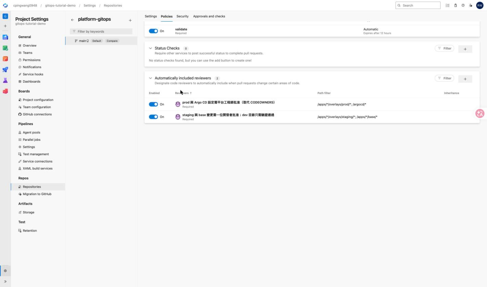

效果等同第 5 章的 CODEOWNERS 加上第 6 章的 dev 自動合併：

- 只改 dev overlay 的 PR（機器人開的 tag 更新）沒有審核要求，Build validation 通過就能完成，搭配 `--auto-complete` 自動合併。
- 改 staging overlay 或 base，自動加入開發者團隊為必要審核者。
- 改 prod overlay 或 Argo CD 設定，自動加入 Platform Engineers 為必要審核者。

為什麼不用 Minimum number of reviewers：它對整個分支生效，機器人開的 dev PR 也會卡住等人批准，就失去第 6 章 dev 自動部署的效果。

```bash
az repos policy required-reviewer create --repository-id <platform-gitops ID> --branch main \
  --required-reviewer-ids "[gitops-tutorial-demo]\Platform Engineers" \
  --path-filter "/apps/*/overlays/prod/*;/argocd/*" \
  --message "prod 與 Argo CD 設定需平台工程師批准" --blocking true --enabled true
az repos policy required-reviewer create --repository-id <platform-gitops ID> --branch main \
  --required-reviewer-ids "[gitops-tutorial-demo]\gitops-tutorial-demo Team" \
  --path-filter "/apps/*/overlays/staging/*;/apps/*/base/*" \
  --message "staging 與 base 變更需一位開發者批准" --blocking true --enabled true
```

Config Repo 的 PR 驗證：

```yaml
# platform-gitops/azure-pipelines/pr-check.yml
trigger: none
pool:
  vmImage: ubuntu-latest
steps:
  - script: |
      curl -sSL https://github.com/yannh/kubeconform/releases/download/v0.6.7/kubeconform-linux-amd64.tar.gz | tar xz
      for d in apps/*/overlays/*/; do
        kubectl kustomize "$d" | ./kubeconform -strict -summary
      done
    displayName: kustomize build + kubeconform
  - script: |
      docker run --rm -v "$(pwd):/repo" zricethezav/gitleaks:v8.21.2 detect --source=/repo --no-git -v
    displayName: gitleaks
```

## Step 7 開發：分支、Commit 與 Draft PR

小林的節奏與第 2、3 章相同，只把 `#42` 換成 `AB#1`。

```bash
git switch -c feat/1-coupon-discount
git commit -m "feat(order): apply discount and enforce zero floor (AB#1)"
git push -u origin feat/1-coupon-discount
az repos pr create --draft true \
  --source-branch feat/1-coupon-discount --target-branch main \
  --title "feat: coupon discount at checkout" \
  --work-items 1 --description "$(cat pr-body.md)"
```

在網頁上建立時，Create 按鈕的下拉選單選 **Create as draft**。ADO 會從 commit 訊息的 `AB#1` 自動帶出要連結的 Work Item。

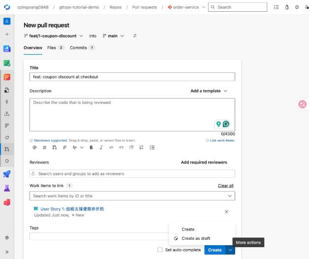

建立後的 Draft PR !1：

- 左上角有 **Draft** 標記，右上是 **Publish**（等同 GitHub 的 Ready for review）。
- 「No reviewers notified in draft mode」：Draft 期間不打擾 Reviewer。
- Build validation 的 `pr-check` 已列為必要檢查。
- Description 的 `- [ ]` 渲染成可勾選的工項 Checklist。
- 右下 Work items 連到 User Story 1。

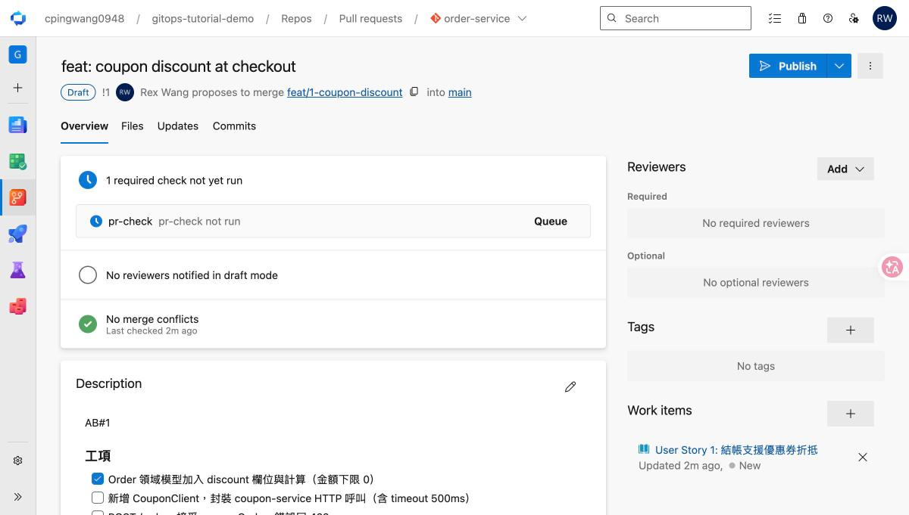

接著小林依第 3 章的節奏小步推送，每個 commit 都帶 `AB#1`：

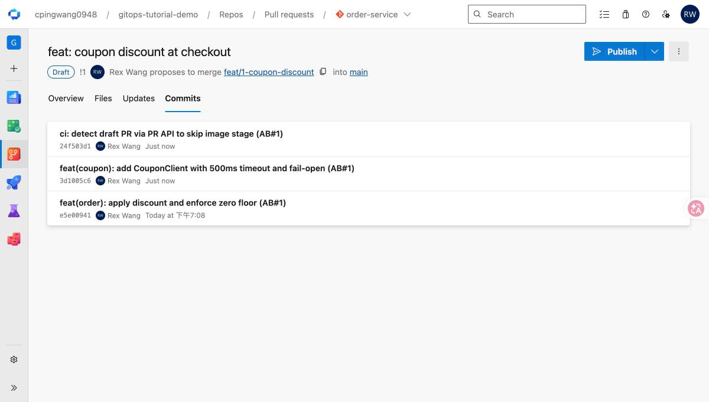

回到 User Story 1，Development 區塊已自動列出 PR 與 commit，第 10 章的「需求 → 程式碼」追溯不用手動維護：

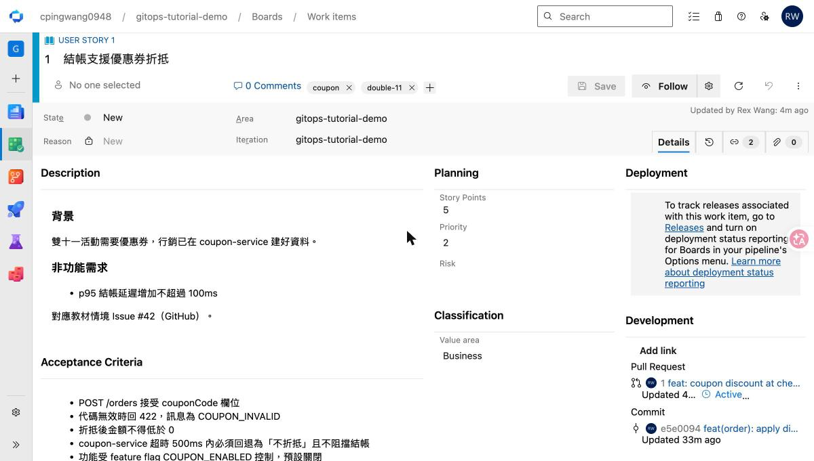

## Step 8 第一次執行 PR 驗證：兩個新組織常見的關卡

小林在 PR 上按 **Queue** 跑 `pr-check`，遇到兩個 GitHub 上不會遇到的關卡。

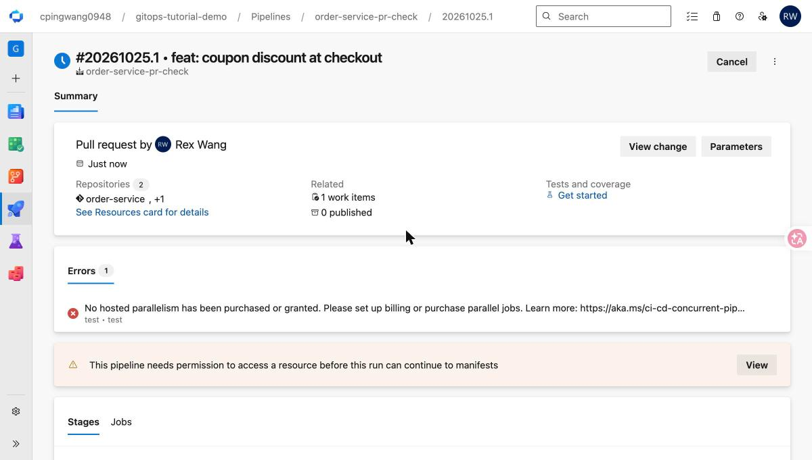

### 關卡一：跨 Repo checkout 需要授權

`manifests` stage 要 checkout `platform-gitops`，第一次執行時 Pipeline 會停下來等待授權。按 **View** → **Permit** → 再按一次 **Permit** 確認，之後這條 Pipeline 都可以讀這個 Repo。

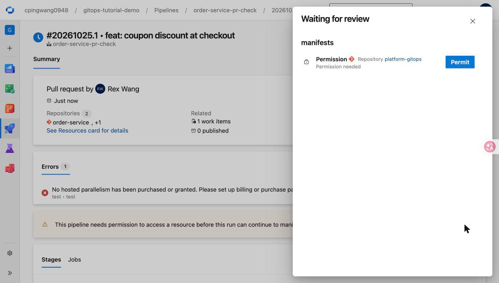

這是 ADO 的「Limit job authorization scope」安全預設：Pipeline 只能存取自己的 Repo，要讀其他 Repo 必須明確授權，與第 9 章的最小權限原則一致。

### 關卡二：No hosted parallelism has been purchased or granted

新建立的 ADO 組織，Microsoft-hosted agent 的 parallel jobs 預設是 0（Project/Organization settings → Pipelines → Parallel jobs）。本示範組織實際狀態如下，Private 專案的 Microsoft-hosted 為 0、Self-hosted 有 1 個免費名額：

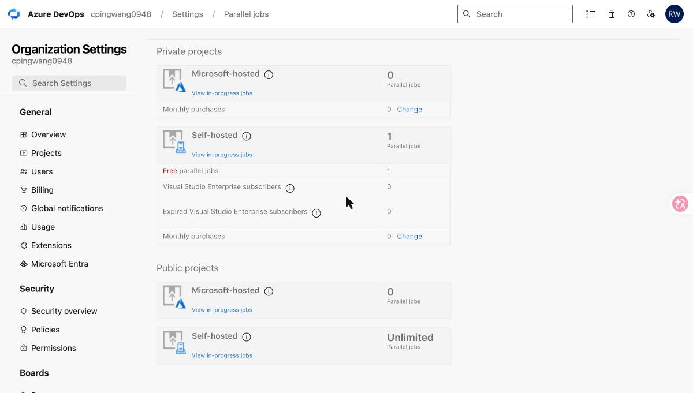

所以所有 stage 都在排隊階段失敗：

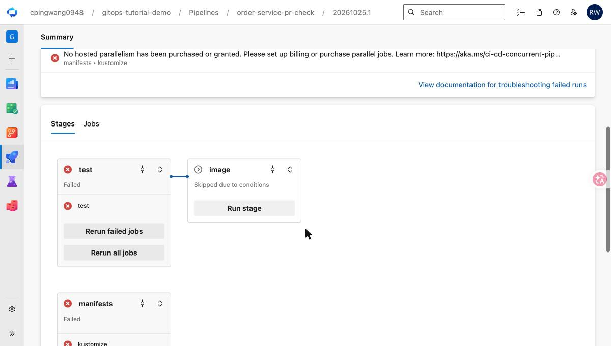

三種解法：

| 做法 | 適合 | 備註 |
| --- | --- | --- |
| 申請免費額度 | 個人或試用 | 填寫 Microsoft 的 free tier 申請表（[aka.ms/azpipelines-parallelism-request](https://aka.ms/azpipelines-parallelism-request)），審核需要幾個工作天 |
| 購買 Microsoft-hosted parallel job | 正式團隊 | Organization settings → Billing 連結 Azure 訂閱後，在 Parallel jobs 調整數量 |
| 自建 Agent（Self-hosted） | 需要連內網、或已有 AKS | Private 專案有 1 個免費名額；可在 AKS 上用 KEDA 依佇列長度擴縮 agent |

YAML 只需改 `pool`：

```yaml
pool:
  name: aks-agents        # 改用自建 agent pool
```

> 本示範組織在撰寫時尚未取得 hosted parallelism，所以截圖停在排隊失敗。取得額度後，在 PR 頁面重新 Queue 即可；Draft 狀態下 `image` stage 會顯示 Skipped due to conditions，轉 Publish 後重跑才會建置與掃描。

## Step 9 Review 與合併

Publish 之後的流程對應第 5 章：

1. 小林按 **Publish**，Reviewer 才會收到通知。Draft 期間跑過的 Build validation 若已過期（本示範設 12 小時），按 Queue 重跑一次，這次 `image` stage 會執行。
2. 阿華逐行審查，留言後狀態為 Active；小林修正並 push，阿華的批准會被重置（Branch Policy 的「Reset all approval votes」），需重新批准。
3. 所有留言 Resolve、`pr-check` 綠燈、至少一人批准、已連 Work Item 之後，**Complete** 按鈕才能按。
4. Complete 對話框的 Merge type 只會出現 **Squash commit**；勾選 **Complete associated work items after merging**（User Story 會轉為 Resolved/Closed）與 **Delete feat/1-coupon-discount after merging**。

Squash commit 訊息沿用第 5 章的格式，第一行用 PR 標題 `feat: coupon discount at checkout`，第 6 章的 semantic-release 才算得出 1.8.0。

## Step 10 交付：release Pipeline 與 Config Repo 的 PR

對應第 6 章，合併到 main 後由 `order-service-release` 執行：

```yaml
# azure-pipelines/release.yml
trigger:
  branches: { include: [main] }
pr: none

pool:
  vmImage: ubuntu-latest

variables:
  ACR_NAME: acrplatform
  IMAGE: acrplatform.azurecr.io/order-service

steps:
  - checkout: self
    fetchDepth: 0
    persistCredentials: true

  # 1. 從 Conventional Commits 算版本號並打 tag（設定在 .releaserc.json）
  - script: npx -y -p semantic-release@24 -p @semantic-release/exec@6 semantic-release
    displayName: semantic-release
    workingDirectory: $(Build.SourcesDirectory)/order-service

  # 2. Workload Identity Federation 的 Service Connection 登入 Azure，建置、推送、簽章
  - task: AzureCLI@2
    displayName: build & push to ACR
    condition: and(succeeded(), ne(variables['VERSION'], ''))
    inputs:
      azureSubscription: sc-acr-wif
      scriptType: bash
      scriptLocation: inlineScript
      inlineScript: |
        az acr login --name $(ACR_NAME)
        cd $(Build.SourcesDirectory)/order-service
        docker build -t $(IMAGE):$(VERSION) -t $(IMAGE):sha-$(Build.SourceVersion) .
        docker push $(IMAGE):$(VERSION)
        docker push $(IMAGE):sha-$(Build.SourceVersion)
        DIGEST=$(docker inspect --format='{{index .RepoDigests 0}}' $(IMAGE):$(VERSION))
        echo "##vso[task.setvariable variable=DIGEST]$DIGEST"
        cosign sign --yes --key azurekms://kv-platform.vault.azure.net/cosign-key "$DIGEST"

  # 3. 往 platform-gitops 開 PR 更新 dev 的 tag，設定 auto-complete
  - checkout: git://$(System.TeamProject)/platform-gitops
    persistCredentials: true
  - script: |
      set -e
      cd $(Build.SourcesDirectory)/platform-gitops
      BR=bot/order-service-dev-$(VERSION)
      git switch -c $BR
      cd apps/order-service/overlays/dev
      kustomize edit set image $(IMAGE)=$(IMAGE):$(VERSION)
      git -c user.name="gitops-bot" -c user.email="bot@platform" commit -am "deploy(dev): order-service $(VERSION)"
      git push origin $BR
      az repos pr create --org $(System.CollectionUri) --project "$(System.TeamProject)" \
        --repository platform-gitops --source-branch $BR --target-branch main \
        --title "deploy(dev): order-service $(VERSION)" \
        --description "自動產生。Image digest: $(DIGEST)" \
        --auto-complete true --squash true --delete-source-branch true
    displayName: open PR to platform-gitops (dev)
    condition: and(succeeded(), ne(variables['VERSION'], ''))
    env:
      AZURE_DEVOPS_EXT_PAT: $(System.AccessToken)
```

`.releaserc.json` 讓 semantic-release 不碰 GitHub 與 npm，只算版本、打 tag，並把版本號寫回 Pipeline 變數：

```json
{
  "branches": ["main"],
  "tagFormat": "v${version}",
  "plugins": [
    "@semantic-release/commit-analyzer",
    "@semantic-release/release-notes-generator",
    ["@semantic-release/exec", {
      "publishCmd": "echo \"##vso[task.setvariable variable=VERSION]${nextRelease.version}\""
    }]
  ]
}
```

要讓這條 Pipeline 跑得起來，還需要三項一次性設定：

| 設定 | 位置 | 內容 |
| --- | --- | --- |
| Service Connection `sc-acr-wif` | Project settings → Service connections → Azure Resource Manager → **Workload Identity federation** | 授予該身分 ACR 的 AcrPush、Key Vault 金鑰的 Sign 權限；沒有任何密碼 |
| Build Service 對 `order-service` 的權限 | Project settings → Repositories → order-service → Security → `gitops-tutorial-demo Build Service` | Contribute、Create tag（semantic-release 推 tag 用） |
| Build Service 對 `platform-gitops` 的權限 | 同上，選 platform-gitops | Contribute、Create branch、Contribute to pull requests |

### 為什麼 cosign 改用 Key Vault 金鑰

第 6、9 章的 keyless 簽章依賴 GitHub Actions 的 OIDC token 被 Sigstore Fulcio 信任，Kyverno 再用 `subject` 驗證「是 release.yml 在 main 建置的」。Azure Pipelines 不是 Fulcio 支援的身分來源，所以改用存在 Key Vault 的非對稱金鑰簽章，Kyverno 政策改成驗公鑰：

```yaml
verifyImages:
  - imageReferences: ["acrplatform.azurecr.io/*"]
    attestors:
      - entries:
          - keys:
              kms: azurekms://kv-platform.vault.azure.net/cosign-key
```

「只有 release Pipeline 能簽」的保證改由 Key Vault 的存取權限承擔：只有 `sc-acr-wif` 的身分有 Sign 權限。

### dev 的自動合併

`--auto-complete true` 讓 PR 在所有 Branch Policy 通過後自動完成，效果等同第 6 章的 auto-merge 標籤。因為 Step 6 的審核要求只綁在 staging、base、prod 與 argocd 路徑，只改 dev overlay 的機器人 PR 在 `validate` 通過後就會自動合併；staging 與 prod 仍要有人按，與第 6 章一致。

## Step 11 Argo CD 改從 Azure Repos 拉取

Argo CD 的部分幾乎不用動，第 7 章的 Application 只改 `repoURL`：

```yaml
spec:
  source:
    repoURL: https://dev.azure.com/cpingwang0948/gitops-tutorial-demo/_git/platform-gitops
    targetRevision: main
    path: apps/order-service/overlays/dev
```

### Repo 憑證：優先用 Azure Workload Identity

Argo CD 官方文件支援以 Azure Workload Identity 存取 Azure Repos，不需要 PAT：

```yaml
apiVersion: v1
kind: Secret
metadata:
  name: repo-platform-gitops
  namespace: argocd
  labels:
    argocd.argoproj.io/secret-type: repository
stringData:
  type: git
  url: https://cpingwang0948@dev.azure.com/cpingwang0948/gitops-tutorial-demo/_git/platform-gitops
  useAzureWorkloadIdentity: "true"
```

前置條件（依 Argo CD 文件）：repo-server Pod 加上 label `azure.workload.identity/use: "true"`、repo-server 的 ServiceAccount 加上 annotation `azure.workload.identity/client-id`，並在 ADO 把該身分加入組織、給 `platform-gitops` 的 Read 權限。

舊版 Argo CD 不支援時，退而用 PAT（Scope 只勾 Code: Read），存入同一個 Secret 的 `username`、`password` 欄位，並設定到期日與輪替流程。

### Webhook：Service Hooks

對應第 7 章的 GitHub Webhook。Project settings → Service hooks → **Web Hooks** → Trigger 選 **Code pushed**，Repository 選 `platform-gitops`、Branch 選 `main`，URL 填 `https://argocd.example.com/api/webhook`。Argo CD 支援 Azure DevOps 的 Basic Auth，在 `argocd-secret` 設定相同的帳密：

```yaml
stringData:
  webhook.azuredevops.username: argocd-hook
  webhook.azuredevops.password: <與 Service Hook 設定相同>
```

這組帳密不要寫進 Git，依第 9 章的做法放在 Key Vault，由 External Secrets Operator 同步。

## Step 12 晉升、回滾、稽核：做法不變

第 8 到 10 章的動作全部是對 platform-gitops 開 PR，在 ADO 的操作對照：

| 動作 | 指令 |
| --- | --- |
| 晉升 staging | `az repos pr create --repository platform-gitops --title "deploy(staging): order-service 1.8.0" --work-items 1` |
| 晉升 prod | 同上；PR 自動加入 Platform Engineers 為必要審核者（Step 6） |
| 回滾 | 在已完成的 PR 頁面按 **Revert**，ADO 會建立 revert 分支並開新 PR；或照第 8 章 `git revert` 後開 PR |
| 事故 PR 自審 | 不建議放寬 Branch Policy；改給 Platform Engineers「Bypass policies when completing pull requests」權限，ADO 會在 PR 留下 bypass 紀錄 |
| 稽核 | `git log` 照舊；另有 Organization settings → **Auditing**，記錄 Branch Policy、權限、Service Connection 的變更 |

ADO 的 PR 頁面內建 Revert 按鈕，與第 8 章「回滾也是 PR」的原則完全一致：回滾後的 commit 仍在 main，Argo CD 依舊從 Git 拉取。

## 常見問題

| 症狀 | 原因 | 處理 |
| --- | --- | --- |
| No hosted parallelism has been purchased or granted | 新組織的 Microsoft-hosted parallel jobs 為 0 | 見 Step 8 |
| This pipeline needs permission to access a resource | 跨 Repo checkout 需授權 | 在 Run 頁面 Permit |
| PR 的 Complete 按鈕是灰的 | 有 Required policy 未通過 | PR Overview 會列出未通過的項目 |
| semantic-release 推 tag 失敗 403 | Build Service 沒有 Create tag 權限 | Repo Security 授權 |
| `az repos pr create` 失敗 TF401027 | Build Service 對 platform-gitops 沒有 Contribute to pull requests | Repo Security 授權 |
| Argo CD 顯示 authentication required | repo-server 的 Workload Identity 未生效或身分不在 ADO 組織中 | 檢查 Pod label、SA annotation 與 ADO 使用者清單 |

## 本章在情境中的位置

平台組在 ADO 上重建了第 1 到第 10 章的流程：User Story #1 對應 Issue #42，Draft PR !1 有八項工項與三個 commit，Branch Policies 取代 Branch Protection 與 CODEOWNERS，三條 Pipeline 已建立並掛上 Build validation。下一步是取得 hosted parallelism 或建好自建 agent，讓 PR 驗證跑出第一個綠燈，接著 Publish、合併，release Pipeline 產出 1.8.0，往後的晉升與回滾都由 Argo CD 從 Azure Repos 拉取完成。
